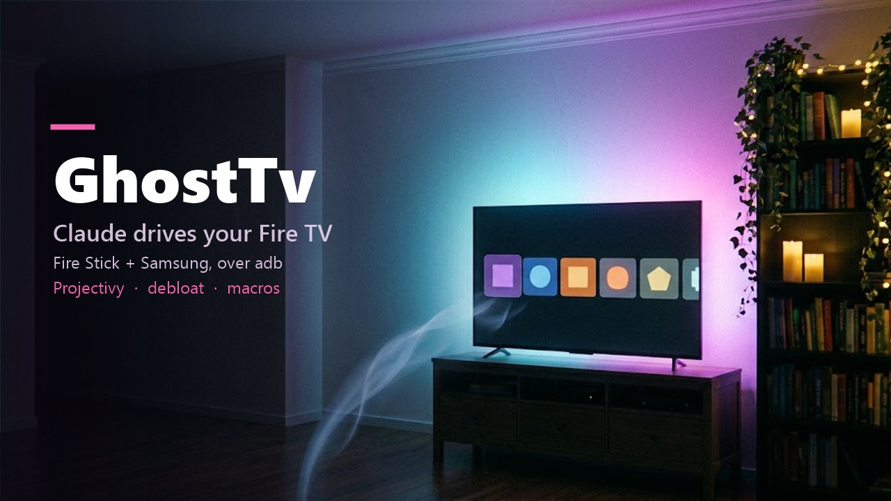

# GhostTv



Control a Fire TV Stick and a Samsung (Tizen) TV from a Windows PC with Claude Code: remote keys, open apps, read HDMI logs, debloat the stick.

**[Tutorial with screenshots + live demo](docs/TUTO.md)** · **[Download latest](https://github.com/ghostaiproject/GhostTv/releases/latest/download/GhostTv.zip)** · [All releases](https://github.com/ghostaiproject/GhostTv/releases)

## Install
```powershell
git clone https://github.com/ghostaiproject/GhostTv; cd GhostTv
powershell -File install.ps1
```
This copies `skill/` to `~/.claude/skills/firetv`, so Claude Code picks up the `firetv` skill. Requires Python 3 (Samsung part). adb is installed on first use via winget.

## One-time setup on the devices
1. Fire Stick: Settings → My Fire TV → Developer options → **ADB debugging: On** (tap "About → device name" 7× to show Developer options).
2. `powershell -File skill\firetv.ps1 set <stickIP> <tvIP>` (Claude can find the IPs: stick = port 5555 open, TV = port 8002 open).
3. First Fire Stick command → TV asks "Allow USB debugging?" → tick **Always allow**, OK.
4. First Samsung key → TV asks to allow **ClaudeRemote** → Allow.

IPs live in `~/.claude/firetv.json` and the TV pairing token in `~/.claude/samsung-token.txt`, never in this repo.

## Commands
| Fire Stick: `firetv.ps1` | Samsung: `python -I samsung.py` |
|---|---|
| `info` · `apps` · `logs [pattern]` · `shot` | `info` · `keys` |
| `key home back up down left right ok play volup power sleep` | `key power volup voldown mute source hdmi1 home back ok KEY_*` |
| `text <words>` · `app netflix\|prime\|youtube\|plex\|kodi\|<pkg>` · `stop <app>` | |
| `debloat [track shop unused recs]` · `restore [pkg]` | |

## Debloat
`skill/bloat.txt` lists Amazon apps by group: **track** (metrics, telemetry, ad ID, ACR), **shop** (Shop TV, miniTV, promos, tutorials), **unused** (ambient, Photos/Music hubs, Game Hub), **recs** (home recommendations). Removal is per user (`pm uninstall --user 0`, or `pm suspend` for protected ones) and logged in `~/.claude/firetv-removed.txt`; `restore` puts everything back. Updates, launcher, settings, Appstore, Alexa, DRM and CEC/IR control are never touched.

## HDMI drops when opening Netflix/Prime
`firetv.ps1 logs`: no hotplug/mode-change lines → the TV is cutting the signal. Fix order: Samsung **Input Signal Plus** on for that HDMI port → Fire Stick **HDMI CEC Device Control off** + Samsung **Anynet+ off** → replug with the HDMI extender + Amazon wall adapter → try another HDMI port.
