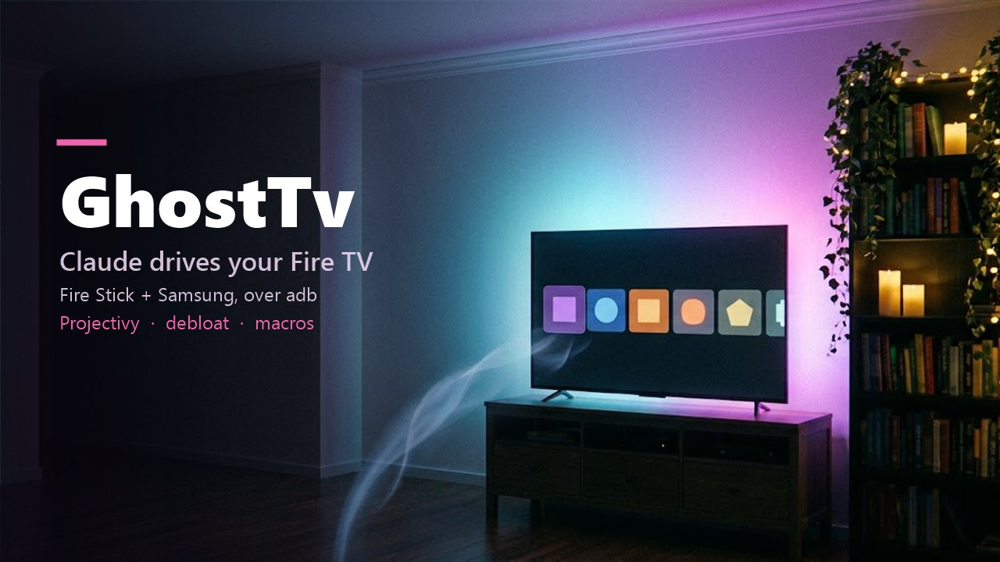
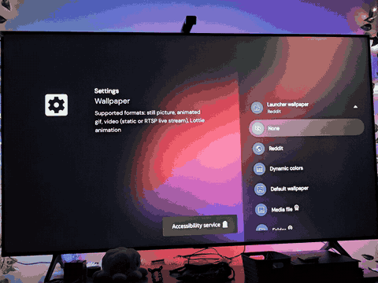
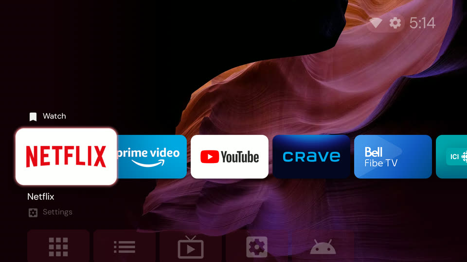
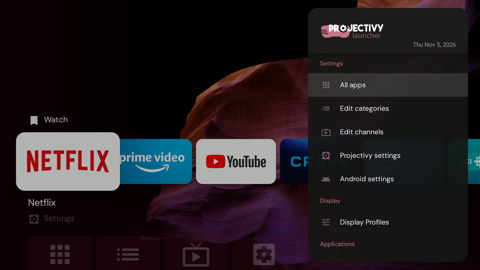
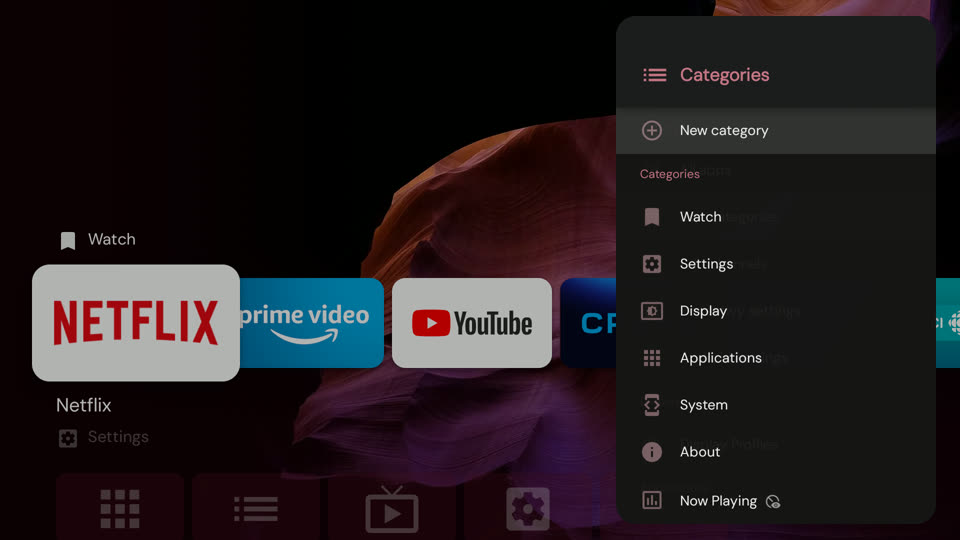
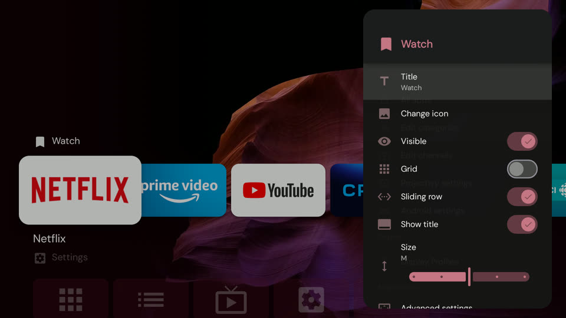
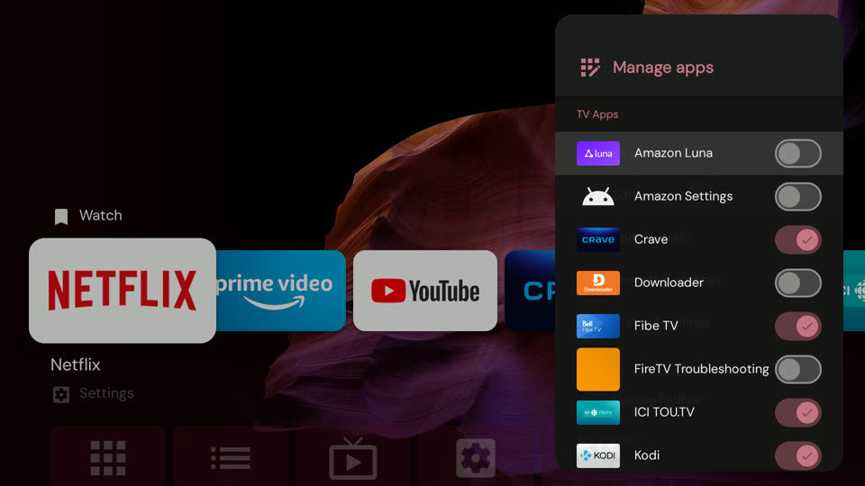
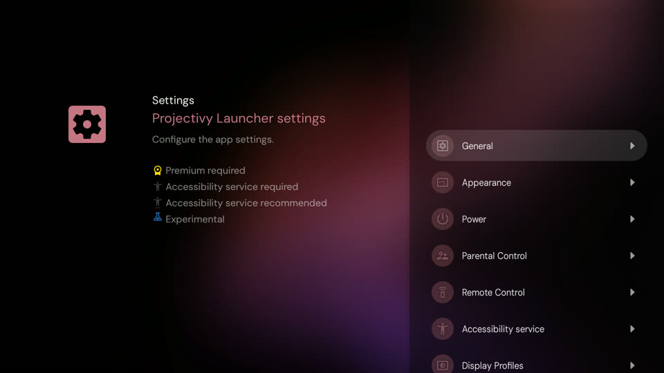
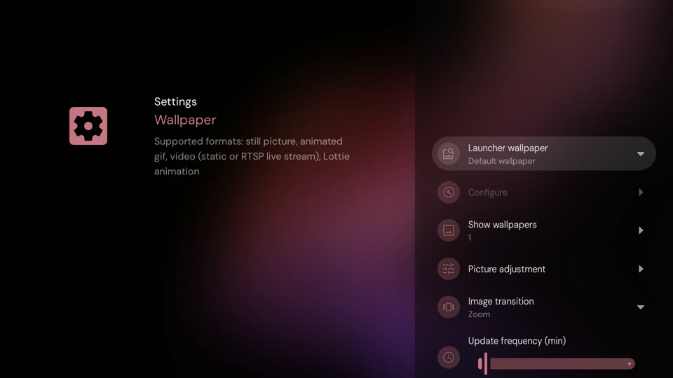

# GhostTv tutorial: let Claude set up your Fire TV

Claude Code drives a Fire TV Stick (and a Samsung TV) from your Windows PC over adb: it presses the remote keys, reads the screen, and does every setting itself. You only approve the security prompts on the TV.

*Live: Claude picks the Projectivy wallpaper while the PC sends the keys ([TV clip](media/tv-live.mp4) · [PC side](media/pc-side.mp4)).*

## Download

| Version | Package | Notes |
|---|---|---|
| **Latest** | [GhostTv-latest.zip](https://github.com/ghostaiproject/GhostTv/releases/latest/download/GhostTv.zip) | Always the newest release |
| v1.0.0 | [GhostTv-v1.0.0.zip](https://github.com/ghostaiproject/GhostTv/releases/download/v1.0.0/GhostTv.zip) | Projectivy setup, fast nav macros |
| Dev (main) | [main.zip](https://github.com/ghostaiproject/GhostTv/archive/refs/heads/main.zip) | Unreleased changes |
| All releases | [Releases page](https://github.com/ghostaiproject/GhostTv/releases) | Every version + notes |
| Projectivy Launcher | [spocky/miproja1 releases](https://github.com/spocky/miproja1/releases) | Universal APK (Claude installs it) |

## 1. Install (PC, 1 minute)
1. Unzip the package (or `git clone https://github.com/ghostaiproject/GhostTv`).
2. Run `powershell -File install.ps1`. It copies the `firetv` skill into `~/.claude/skills/firetv`.
3. adb is installed on first use (winget). Python 3 is needed only for the Samsung part.

## 2. One-time steps on the TV (you)
1. Fire Stick: **Settings → My Fire TV → About**, click the device name 7 times, then **Developer options → ADB debugging: On**.
2. Ask Claude: *"set up my Fire TV"*. It finds the stick and TV IPs on your network.
3. The TV asks **Allow USB debugging?** → tick **Always allow** → OK.
4. Samsung TV asks to allow **ClaudeRemote** → Allow.

That is all you do. Every step below is Claude, over adb.

## 3. What Claude does for you

| Step | Command Claude runs | Result |
|---|---|---|
| Fix HDMI drops | `firetv.ps1 logs` | Finds whether the TV or stick cuts the signal |
| Debloat | `firetv.ps1 debloat` | Removes Amazon trackers/promos (`restore` undoes) |
| UX preset | `firetv.ps1 ux` | Faster animations, ads + usage data off |
| Projectivy | installs the APK, you allow its accessibility | Home button opens Projectivy |
| Build the home | `firetv.ps1 run watch-apps` … | One clean row of your apps |

## 4. The Projectivy home, step by step

**Result: one clean row, no Amazon rows, calm wallpaper.**

1. **Menu** opens Projectivy's panel → **Edit categories**.
   
2. **New category** → title *Watch* (Fire keyboard: type, then **Next**).
   
3. Row options: Visible, Grid, Sliding row, Size → **Advanced settings → Sort: Custom**.
   
4. **Manage apps**: tick apps in the order you want them (tick order = row order). Netflix, Prime, YouTube, Crave, Fibe TV, Tou.tv, TVA+, Plex, Kodi.
   
5. Back in Edit categories, open **TV Apps** and **Mobile Apps** → **Visible: off** (eye icon = hidden).
6. **Projectivy settings → Appearance → Wallpaper** → **Default wallpaper** (Reddit = random photos).
   
   

## 5. Fast control (how Claude moves)
- `firetv.ps1 go <keys>`: all keys in one batch (one monkey run, ~0.15 s/key), then a small screenshot.
- `firetv.ps1 run <macro>`: replays a saved path from [`skill/nav/`](../skill/nav/README.md) (`watch-apps`, `wallpaper`, `categories`).
- `wait` = 1 s pause after `home`, `menu` or opening a screen, so keys never land on the old screen.
- `firetv.ps1 ui`: lists the on-screen texts (makes Projectivy show an "Accessibility service" toast; harmless).

## Troubleshooting
| Problem | Fix |
|---|---|
| "Accessibility service" toast on TV | Caused by `ui` reads; the service stays on. Claude uses screenshots instead. |
| Screenshot is empty | A DRM app (Netflix, Prime) is open: `firetv.ps1 stop netflix`. |
| A key opened an app | A `wait` was missing after `home`/`menu`: add it to the macro. |
| Unauthorized | Approve **Always allow** on the TV prompt again. |
